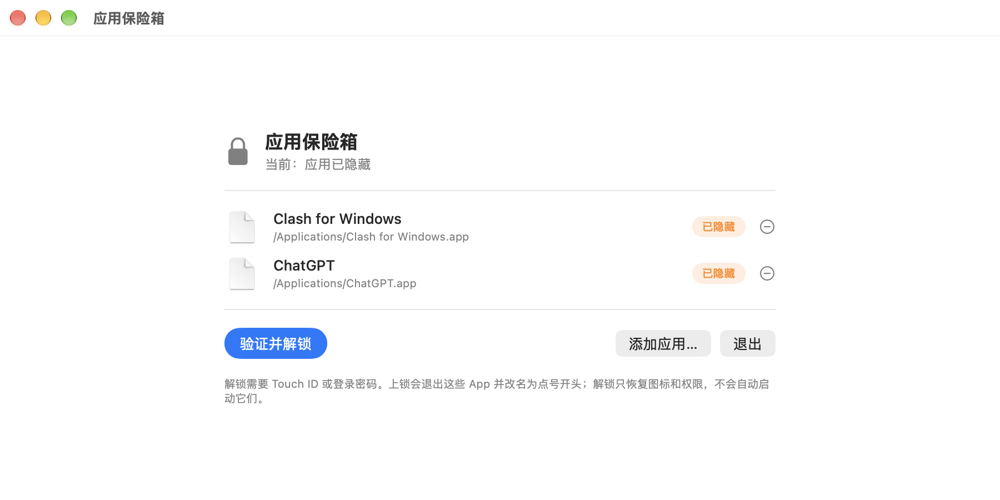

# AppVault

> Hide any macOS app in place — invisible and unlaunchable until you authenticate with Touch ID.

**English** | [简体中文](README.md)

AppVault keeps selected apps where they are and makes them disappear: not in Spotlight, not in Finder, not launchable. They only come back after you authenticate with Touch ID (or your login password) inside AppVault.



## Features

- **Hidden in place**: no moving, no bundling — locking only temporarily prefixes the bundle name with a `.`
- **Really gone**: not found by Spotlight, invisible in Finder, double-click reports “permission denied”
- **Biometric unlock**: Touch ID, with automatic fallback to the login password
- **Manageable list**: add apps (multi-select) and remove them (with a confirmation dialog) from the UI
- **Non-intrusive unlock**: restores icons and permissions only — it never launches your apps for you
- **Small**: one source file, no third-party runtime dependencies, MIT licensed

## How it works

| Phase | Command | Effect |
|---|---|---|
| Lock | `chflags hidden <app>` | Hidden in Finder |
| Lock | `chmod 000 <app>` | Unreadable / not launchable |
| Lock | Rename to `.Name.app` | Removes it from Spotlight (required — `chmod` alone leaves the old index entry) |
| Unlock | Rename back → `chmod <original mode>` | Restores access |
| Unlock | `chflags nohidden <app>` + `mdimport` | Visible and indexed again |

Order matters: **on lock, drop permissions first and rename second** (a renamed path is treated as a new app and then refuses modification); reverse this on unlock.

Authentication uses the system `LocalAuthentication` framework (`.deviceOwnerAuthentication`). No password is ever stored.

## Build

```bash
git clone https://github.com/Inkpaper-mz/AppVault.git
cd AppVault
./build.sh
# output: build/AppVault.app
```

Requires Xcode Command Line Tools (for `swiftc`). Generating the icon additionally needs Python 3 with Pillow.

## Install & use

```bash
ditto build/AppVault.app "/Applications/AppVault.app"
open "/Applications/AppVault.app"
```

- “Add App…” at the bottom opens a file picker (starts in `/Applications`, multi-select supported)
- The **−** button on each row removes that app from the list after confirming; if the app is currently hidden it is restored first
- If restoring is refused by the system, the removal is **cancelled** so an app can never be left permanently hidden
- “Lock” hides everything in the list; “Unlock” asks for Touch ID and only restores visibility (no auto-launch)
- The menu bar item offers the same Lock / Unlock actions

## Configuration

`~/Library/Application Support/AppVault/config.json`:

```json
[
  { "path": "/Applications/Clash for Windows.app" },
  { "path": "/Applications/ChatGPT.app" }
]
```

Restart AppVault after editing.

## Known limitations

1. **Apps installed from the App Store are protected by macOS “App Management.”** The first time AppVault modifies one, macOS will ask for permission; if no prompt appears, enable AppVault under System Settings › Privacy & Security › App Management and retry.
2. Locking **quits** the target app (otherwise its menu bar icon would remain); unlocking only restores the icon and permissions — you launch the app yourself.
3. Builds are unsigned and not notarized; right-click → Open the first time.
4. Hiding is not encryption: it prevents casual discovery and launching, not access by someone who already has your account privileges.

## Security notes

- No network access, no telemetry, no data collection
- Only the apps in the configured list are renamed or have their permissions changed
- The “App Management” permission is used solely to modify App Store–installed apps

## Acknowledgements

- This project is an **original implementation**; no third-party source code was copied.
- It uses Apple frameworks shipped with macOS: SwiftUI, AppKit, LocalAuthentication, UniformTypeIdentifiers (no attribution required).
- Prior art consulted for positioning only (no code used):
  - [MakLock](https://github.com/dutkiewiczmaciej/MakLock)
  - [MacShield](https://github.com/AryanVBW/MacShield)
- The app icon is generated by [`scripts/generate_icon.py`](scripts/generate_icon.py) in this repository.

## License

[MIT](LICENSE) © 2026 Inkpaper-mz

## Contributors

- [Inkpaper-mz](https://github.com/Inkpaper-Mz) — author & maintainer
- [DeepSeek](https://github.com/deepseek-ai) — AI pair programmer (architecture, implementation, debugging, docs)
