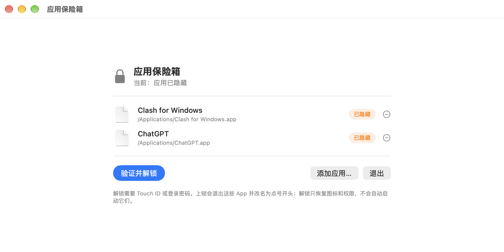

# 应用保险箱 AppVault

> Hide any macOS app in place — invisible and unlaunchable until you authenticate with Touch ID.

macOS 上的「应用保险箱」：把指定的 App **原地隐藏**，只有在保险箱里通过 Touch ID / 登录密码验证后才重新出现。



## 特性

- **原地隐藏**：不改路径、不移动、不打包，上锁时只在名字前临时加一个 `.`
- **彻底消失**：Spotlight 搜不到、访达看不见、双击提示“没有权限打开”
- **生物识别**：Touch ID 解锁，不可用时回退到登录密码
- **列表可管理**：界面内添加（可多选）与移除（带确认弹窗）
- **解锁不打扰**：只恢复图标和权限，不会自动启动 App
- **轻量**：源码单文件、无第三方运行时依赖、MIT 许可

## 工作原理

| 时机 | 操作 | 作用 |
|---|---|---|
| 上锁 | `chflags hidden <app>` | 访达隐藏 |
| 上锁 | `chmod 000 <app>` | 无法读取 / 启动 |
| 上锁 | 改名为 `.Name.app` | Spotlight 彻底搜不到（关键一步，`chmod` 清不掉已有索引） |
| 解锁 | 改回原名 → `chmod <原权限>` | 恢复访问 |
| 解锁 | `chflags nohidden <app>` + `mdimport` | 重新可见、重新索引 |

顺序很重要：**上锁时先断权限再改名**（改名后的路径会被系统当成新 App 而拒绝修改），解锁时反过来。

身份验证使用系统 `LocalAuthentication`（`.deviceOwnerAuthentication`），不保存任何密码。

## 构建

```bash
git clone https://github.com/<your-name>/AppVault.git
cd AppVault
./build.sh
# 产物：build/AppVault.app
```

依赖：Xcode Command Line Tools（提供 `swiftc`）。生成图标另需带 Pillow 的 Python 3。

## 安装与使用

```bash
ditto build/AppVault.app "/Applications/应用保险箱.app"
open "/Applications/应用保险箱.app"
```

- 底部「添加应用…」可多选加入任意 `.app`（默认定位到 `/Applications`）
- 每行右侧「−」从列表移除，会先弹窗确认；若该 App 正被隐藏，会先自动恢复再移除
- 恢复被系统拒绝时会**拒绝移除**并提示先解锁，避免 App 被永久藏起来
- 点「重新上锁」→ 列表里的 App 全部消失；点「验证并解锁」→ Touch ID 后恢复（不会自动打开）
- 菜单栏也有「上锁 / 验证并解锁」入口

## 配置

`~/Library/Application Support/AppVault/config.json`：

```json
[
  { "path": "/Applications/Clash for Windows.app" },
  { "path": "/Applications/ChatGPT.app" }
]
```

改完重启保险箱生效。

## 已知限制

1. **App Store 安装的 App 受 macOS「App 管理」保护**。保险箱首次修改这类 App 时系统会要求授权；若没有弹窗，请到「系统设置 › 隐私与安全性 › App 管理」中允许「应用保险箱」，再重试。
2. 上锁会**退出**正在运行的 App（否则菜单栏里还会看到它的图标）；解锁只恢复图标和权限，需要你自己打开 App。
3. 本项目未签名、未公证，自行构建的 App 首次打开可能需要右键 → 打开。
4. 隐藏不是加密：它防的是“随手被看见、随手被打开”，能拿到你账户权限的人仍可在解锁后访问。

## 安全说明

- 不联网、不收集任何数据
- 只对配置列表中的 App 执行重命名与权限修改，不触碰其他文件
- 需要「App 管理」授权仅用于修改 App Store 安装的应用

## 致谢与第三方说明

- 本项目为**原创实现**，未复制任何第三方项目的源代码。
- 使用 Apple 随 macOS 提供的系统框架：SwiftUI、AppKit、LocalAuthentication、UniformTypeIdentifiers；这些框架无需额外署名。
- 立项思路参考了同类开源项目的定位（仅作对照，未使用其代码）：
  - [MakLock](https://github.com/dutkiewiczmaciej/MakLock)
  - [MacShield](https://github.com/AryanVBW/MacShield)
- 应用图标由本仓库的 [`scripts/generate_icon.py`](scripts/generate_icon.py) 生成。

## 许可证

[MIT](LICENSE) © 2026 Inkpaper-mz
